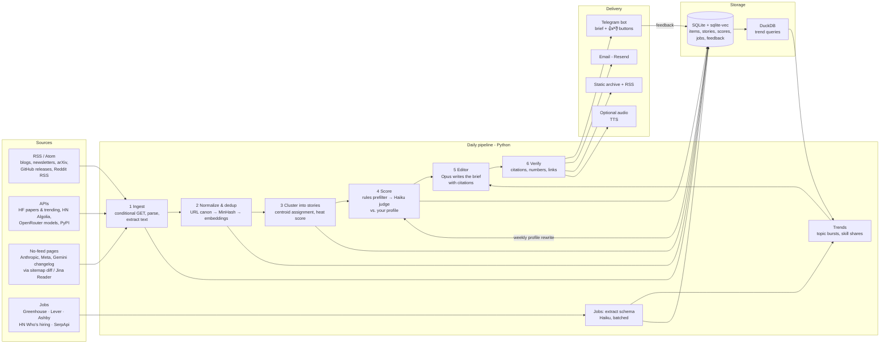

# Architecture proposal: AI_news daily brief

*Draft v0.3, 2026-10-12. Based on [research.md](research.md).*

## 0. v0.2 decisions (these replace earlier sections where they conflict)

| Topic | Decision |
|---|---|
| **Delivery** | A **Telegram channel**, with a bot as channel admin. The bot posts with `sendRichMessage` (Bot API 10.1+: up to 32k characters, headings and tables). Each story has inline 👍/👎/🔇 buttons; `callback_query` gives the identity of whoever clicked. Channel reactions only come back as anonymous aggregate counts (`message_reaction_count`). Long-form copies go to Telegraph. Email is dropped. |
| **Hosting** | **GCP, on a personal project with no organization** (not a work account), in us-west1. This replaces the Hetzner VPS in §5. See the deployment below. **Deployed v1.3 (2026-10-14):** three Cloud Run jobs (jobs + openings 05:00 and brief 06:00, every three days since v1.6; weekly Mon 07:00; your time zone) from Cloud Scheduler, the SQLite file in a private versioned bucket, the bot token in Secret Manager, set up by [infra/deploy.sh](../infra/deploy.sh) with gcloud ([setup §6](setup.md#6-deploy-to-gcp-cloud-run-jobs-on-a-schedule)). Not yet: the evening brief, the feedback webhook and Firestore, Terraform and deploys from GitHub Actions. |
| **LLMs (v0.7, 2026-10-12)** | Gemini 3.1 Flash-Lite still judges; **Gemini 3.5 Flash-Lite ($0.30 / $2.50) now writes the brief**, because the teaching-style notes need better writing. Expected model cost stays about $2–3/month. |
| **LLMs (v0.6, 2026-10-12)** | **Gemini on Vertex AI**, because Claude on Vertex needs an Anthropic access request (business details). Gemini 3.1 Flash-Lite ($0.25 / $1.50 per 1M tokens), the cheapest current model, judges stories, extracts jobs, parses bot edits and also writes the brief: the editor only combines and summarises excerpts it is given. Upgrades if the writing falls short: Gemini 3.5 Flash-Lite ($0.30 / $2.50) or 3.8 Flash ($0.75 / $3.75 until 2026-12-31, then $1.50 / $7.50). Embeddings: gemini-embedding-2. Expected model cost is about $2–3/month. Claude stays as an optional provider (`LLM_PROVIDER=anthropic`). The rest of this document still names the Claude models of v0.2; read them as these Gemini roles. |
| **LLMs (v0.2, superseded)** | All models through **Vertex AI**, on the global endpoint where possible (same prices as Anthropic). Claude Haiku 5.5 for triage and job extraction. Claude Opus 5.5 writes the brief; Claude Sonnet 5.5 is a cheaper option. `gemini-embedding-001` at 768 dimensions for embeddings. Vertex has no Anthropic Message Batches API; Vertex batch prediction can be used instead, at +10% because batch doesn't run on the global endpoint. |
| **Scope** | **From the big picture down to low-level detail**, not only the user's role. The brief has fixed layers, each with its own ranking quota, so stories relevant to one role don't crowd out the rest (see below). |
| **Markets** | Jobs and market research cover **USA, Canada, UK, Switzerland and UAE**. Remote roles are tagged separately. Policy news follows the same five markets plus the EU AI Act. |
| **Profile editing** | **Option B, decided:** you send a plain-text or voice message to the bot, an LLM turns it into a proposed change, and you confirm it. See "Profile management" below. |
| **New module** | **Career fit.** It compares a private skills inventory against the requirements extracted by the jobs pipeline (§3.6) and produces a weekly market-fit report. |

### Deployment on GCP (serverless, ≈ $0–1/month infra)

```
Cloud Scheduler (3 free jobs: brief 06:00+18:00, jobs poll, weekly trends/fit)
   └─► Cloud Run Job "pipeline" (1 vCPU / 2 GiB, parallelism 1)
         1 download SQLite snapshot from GCS ──► ingest ─► embed ─► dedup/cluster
         2 triage (Haiku 5.5) ─► write (Opus 5.5) ─► verify ─► post to Telegram channel
         3 merge feedback from Firestore ─► upload SQLite (ifGenerationMatch)
Cloud Run service "tg-webhook" (scale-to-zero; secret_token header) ─► Firestore (feedback inbox)
Secret Manager (bot token, keys) · Artifact Registry (image, cleanup policy) · budget alert $5
Optional: BigQuery as analytics sink · Chirp 3 HD TTS (1M chars/mo free) for an audio brief
```

How the pieces are wired:
- **State:** a single SQLite file in GCS. Each job downloads it, works on a local copy, and uploads it back. Writing SQLite directly over a GCS FUSE mount is unsafe because FUSE has no file locking.
- **Feedback:** written to Firestore's free tier.
- **Bot:** a webhook, not long polling. On Cloud Run, long polling needs an always-on instance, which costs about $12/month.
- **Infrastructure:** for now a gcloud script ([infra/deploy.sh](../infra/deploy.sh)) run by hand, which builds with Cloud Build; later Terraform, deployed by GitHub Actions to Cloud Run using Workload Identity Federation, so no service-account keys.

### Brief layers (broad → deep)

1. **Big picture:** industry, funding and M&A, policy and regulation, compute and energy.
2. **Models and research:** releases, benchmarks, pricing, papers.
3. **Engineering and tools:** frameworks, SDK changes, agent and RAG practice, evals.
4. **Low-level systems:** inference, kernels, quantization, serving, hardware.
5. **Career and market:** notable postings, skill trends. On Mondays, the weekly market-fit report.

The sources for layers 1 and 4 still need to be expanded and verified. This happens in Phase 1, using the vendor and newsletter list in research.md as a base.

### Career-fit module

**Inputs:**
- The user's private profile: skills, projects, portfolio and targets.
- It lives in Firestore with version history, and is exported weekly to a private GCS bucket. It is never stored in this repo.
- It is imported once from the local job-search folder. After that it is edited **through the Telegram bot** (see "Profile management" below).

**Weekly output:**
- **Coverage:** how much of the demand is covered, weighted by how often each skill appears in target-role postings, filtered to the target regions and role families.
- **Top missing skills,** ranked by demand × trend.
- **Rising skills the user lacks.**
- **Skills the user has that are declining.**

**Daily:** stories that touch a known gap are tagged "📈 gap: <skill>".

### Run lanes (one image, three schedules)

The lanes do **not** call each other. Each is a separate run, and they hand data to each other only through the SQLite snapshot. Inside a lane the steps run in order.

| Lane | Schedule | Steps | Reads | Writes |
|---|---|---|---|---|
| ② Jobs | 05:00, every three days (deployed) | J1 poll & diff → J2 extract (Flash-Lite) → J3 openings for you | Job boards, your skills and openings preferences | Postings, extractions, the day's openings (sent once each) and where you stand |
| ① Brief | 06:00 full, every three days (deployed); an 18:00 changes-only edition is planned | Ingest → dedup → cluster → score → write → verify & publish | Sources, profile, feedback, ② output | Items, stories, scores, briefs |
| ③ Weekly | Mon 07:00 | W1 aggregate & fit → W2 write reports (Flash-Lite) → W3 publish | 7–28 days of ① and ② history, profile | Weekly reports, profile suggestions (sent privately) |

The job runs with parallelism 1 and uploads the snapshot with a GCS generation precondition. Together these guarantee only one writer at a time.

### What is stored

The full table with retention periods is in [architecture-diagram.html](architecture-diagram.html).

| Store | Contents |
|---|---|
| **SQLite** (snapshot kept in GCS) | Source health, items (metadata, plus a 30-day text excerpt), 90-day int8 embeddings, stories, scores and prompt versions, briefs with Telegram message IDs, job postings and extractions, weekly skill statistics, run reports. |
| **Firestore** | Feedback inbox, the versioned profile, bot conversation state. |
| **Secret Manager** | Keys. |

**Not stored:** full article bodies or raw HTML.

**Expected size:** about 1–1.5 GB after a year.

### Profile management via Telegram

**Options considered:**

| Option | How it works | Effort | Trade-off |
|---|---|---|---|
| A. Slash commands | `/skill add MCP level=portfolio evidence="…"`, `/skills`, `/project add` | Low | Precise, but fiddly to type on a phone |
| **B. Plain-text or voice edits** | You send "Shipped an MCP server with FastMCP on Cloud Run for a client demo". Haiku 5.5 turns it into a structured patch. The bot shows a diff with ✅ Apply / ✏️ Edit / ❌ Cancel, and applying saves a new Firestore version. It also accepts a **GitHub repo URL** (reads README and dependency files, then proposes skills with evidence), a **PDF** resume or JD, and **voice notes** (transcribed first) | Medium | The most natural. Needs the confirm step, and fetched content is treated as data, never as instructions |
| C. Telegram Mini App | A button opens a small web form to edit skill levels and projects in bulk. Authenticated with Telegram's signed `initData` | Medium-high | Best UI for bulk edits, and written in **TypeScript**, which closes a portfolio gap |
| D. Private Git repo or Google Sheet as the source of truth | Edit YAML on GitHub mobile, or a Sheet; the job reads it | Low | No bot work, but the edits happen outside Telegram |

**Decided (2026-10-12):** B is the main path, plus A for quick operations: `/skills`, `/gaps`, `/fit`, `/jd <paste>` (match score against a JD), `/undo`, `/export`. C comes later as a TypeScript portfolio piece.

**Security:**
- Profile commands are accepted only from your Telegram user ID, and only in the private chat, never the channel.
- Every change is shown as a diff before it is applied, and every change is versioned.
- Slow work (LLM parsing, reading a repo) goes through Cloud Tasks so the webhook can answer immediately.

**Flow for option B:**
1. Telegram sends the message to the webhook. The webhook answers immediately (200 plus "⏳ parsing…") and queues the work in Cloud Tasks.
2. Input is normalised first:
   - **Voice notes:** the audio is transcribed with a Gemini audio model on Vertex.
   - **URLs:** a GitHub repo's README and dependency files, or a public page, are fetched as *data*.
   - **PDFs:** the text is extracted.
3. Claude Haiku 5.5 receives the current profile JSON and the input. It returns a **strict-schema patch**, a list of operations: `add` / `update` / `remove` on `skills`, `projects`, `targets` or `interests`. Each operation carries a reason and evidence.
4. The patch is validated against the profile schema. If the input is ambiguous (for example, "which project?"), the bot asks one clarifying question instead of guessing.
5. The bot replies with a readable diff and buttons: ✅ Apply · ✏️ Edit · ❌ Cancel.
6. **Apply** writes a new version in a Firestore transaction. `/undo` restores the previous version, and `/history` lists the versions.
7. The next pipeline run reads the new profile version.

**Profile model:**

| Section | Fields |
|---|---|
| `skills[]` | name, category, level (`production` / `portfolio` / `studied` / `learning`), evidence, last_used, interest |
| `projects[]` | role, dates, stack, metrics, links |
| `targets` | roles, regions, remote policy, salary, seniority |
| `interests` / `anti_interests` | used for news ranking |

The weekly run can *propose* updates, for example "you 👍'd six MCP stories and mentioned a demo; add MCP = portfolio?". You approve them in the private chat.

### Coverage: are the sources enough?

**News: not yet.**

The current list is strong on models, research and tools (layers 2–3). It is weak or missing in these areas:

| # | Area | Status | Candidates to add |
|---|---|---|---|
| 1 | **Big picture** (business, funding, policy) | Missing | TechCrunch AI, The Verge AI, Ars Technica AI, Axios AI+, EU AI Act and policy trackers, plus Canada / Switzerland / UAE AI ecosystem news |
| 2 | **Low-level systems** | Missing | PyTorch, NVIDIA technical blog, vLLM/SGLang/LMSYS blogs, SemiAnalysis free posts, Chips and Cheese, GPU MODE, and Raschka, Chip Huyen, Lilian Weng, Hamel Husain, Thinking Machines |
| 3 | **X/Twitter**, where many launches break first | Indirect only, through AINews recaps and HN | Later: the xAI X Search tool over a list of about 50 accounts (about $5–10/mo) |
| 4 | **Chinese labs** (Qwen, DeepSeek, Moonshot, Zhipu) | Partial, via HF and GitHub releases | Their orgs and blogs |
| 5 | **Podcasts and YouTube** | — | Channel RSS, titles only at first |
| 6 | **Paywalled outlets** (The Information, Stratechery) | — | Headlines only |

**Update 2026-10-12:** gaps 1–2 are now filled with verified feeds, listed in [sources-layers.md](sources-layers.md):
- **Business, funding, policy and trends:** 22 sources, including policy feeds for the US, CA, UK, CH, UAE and the EU, and trend sources on where AI is heading and how it changes tech work and jobs.
- **Compute and low-level systems:** 15 sources.

**Jobs:** live since v0.9 (Greenhouse, Lever, Ashby); Workday added in v1.0, see §3.6.

The Greenhouse/Lever/Ashby APIs cover AI-native companies well. They miss:
- **Big tech**, which runs its own career sites.
- **Most enterprises and banks**, especially in Switzerland (UBS, Swiss Re, Roche…), the UAE (G42, ADNOC, banks) and large Canadian employers. These typically use Workday, SuccessFactors or Oracle.

Ways to close the gap:

| Option | Notes |
|---|---|
| (a) SerpApi Google Jobs per region | Indirectly covers LinkedIn, Indeed, jobs.ch and Bayt. 250 searches/mo free, $25 for 1k |
| (b) Workday career-site JSON endpoints, per company | No auth needed, but undocumented, so moderate ToS risk |
| (c) **Your own job-alert emails** (LinkedIn, jobs.ch, Indeed, Bayt) | Collected in a dedicated Gmail label and read with the Gmail API. Legal, because the emails are sent to you |
| (d) Regional open data, e.g. Canada Job Bank | Coverage varies |

**Update 2026-10-12:** the job-source mix for each market is now decided; see [job-sources-markets.md](job-sources-markets.md). Every market uses these:
- the Greenhouse / Lever / Ashby job-board APIs
- the career-site endpoints of the enterprise systems: Workday (banks, pharma, NVIDIA), SuccessFactors, Oracle Recruiting and SmartRecruiters
- SerpApi Google Jobs twice a week, which fits the free tier
- job-alert emails

Per-market extras:

| Market | Extra sources |
|---|---|
| UK | the Reed API, daily |
| Switzerland | swissdevjobs.ch RSS, daily |
| US | USAJobs, weekly |
| UAE | relies mainly on SerpApi and alert emails, because Bayt, GulfTalent and Naukrigulf can't be accessed automatically |

**Measuring coverage:**
- **News recall:** each week, take every story linked by the aggregator newsletters (AINews, TLDR, etc.) and check whether our primary sources already had it. The target is above 90%. Domains that keep getting missed are proposed as new sources in the private chat, with a ➕ button.
- **Jobs recall:** each week, compare SerpApi results against the tracked companies. Companies that are hiring but untracked get their job boards probed and added automatically.

## 1. Goals

**Goals:**
- **One daily brief**, readable in about 10 minutes, covering what an LLM/GenAI engineer or FDE should know today: models, tools and SDK changes, research, community pulse, enterprise implications, and the job market.
- **Personal relevance over popularity:** rank everything against a written profile of your stack, interests and work, and learn from 👍/👎.
- **Each story once:** collapse the same launch reported by 10 sources into a single story, cite the original, and use the number of independent sources as a "heat" signal.
- **Trends, not just news:** daily rising topics, plus a weekly job-market report on which skills new postings require and how that is shifting.
- **Cheap and low-maintenance:** about $20–35/month all-in, Python, one repo, and self-monitoring sources.

**Non-goals for now:** multi-user SaaS, paid X/Twitter firehose, scraping LinkedIn or Indeed.

## 2. System overview



## 3. Components

### 3.1 Source registry (`config/sources.yaml`)

Every source is data rather than code:

```yaml
- id: simonw
  kind: rss              # rss | api | page_diff | jobs_ats | hn | reddit_rss ...
  url: https://simonwillison.net/atom/everything/
  category: tools        # models | tools | research | community | vendor | newsletter | jobs
  weight: 1.0            # trust / authority prior
  role: primary          # primary (original reporting) | aggregator (links get resolved to originals)
  expect_every: 2d       # health check: alert if nothing new within this window
```

**Aggregator newsletters as votes.** TLDR, AINews, The Rundown and Ben's Bites mostly point at other people's content. Their outbound links are extracted and resolved to the originals. Each mention adds heat to the original story instead of creating a duplicate.

AINews is the exception: it also produces original community chatter, so its text is ingested as content too.

**Health monitor.** Each run records the HTTP status, the number of new items and the last new item per source. The brief's footer lists sources that look dead, such as AINews moving feeds again.

**Starter set (~40 sources):**

| Category | Sources |
|---|---|
| Vendors | OpenAI news + dev changelog, Anthropic (sitemap diff + release notes page), DeepMind, Google Developers, Mistral, HF blog, AWS/Azure/GCP AI release notes (filtered) |
| Models & tools | OpenRouter `/models` diff, HF trending models/spaces, GitHub `releases.atom` for ~25 key repos (vllm, sglang, llama.cpp, ollama, transformers, langgraph, pydantic-ai, anthropic/openai SDKs, mcp, claude-code changelog, dspy, litellm…), OSS Insight trending |
| Research | HF Daily Papers (primary), arXiv cs.CL/cs.LG/cs.AI (fallback + long tail) |
| Community | HN (Algolia, points ≥ threshold, AI keywords), r/LocalLLaMA + r/MachineLearning RSS, Bluesky ML researcher list |
| Newsletters | Latent Space/AINews, Simon Willison, Interconnects, Import AI, TLDR AI, Last Week in AI, Ben's Bites |
| Jobs | ATS boards for ~150–300 AI companies, HN Who's hiring (monthly), SerpApi Google Jobs (~130 queries/mo, free tier), Hiring Lab AI tracker (monthly) |

### 3.2 Ingest

Fetching:
- `httpx` with ETag/Last-Modified and per-host rate limits: arXiv 1 request per 3 s, HN Algolia 10k/h, HF with a token.
- `feedparser` for feeds; `trafilatura` for full text, with Jina Reader as the fallback for JS-heavy pages.
- **Page-diff collector** for pages without a feed: fetch, convert to markdown, diff against the last snapshot, and keep new sections.

Every raw item is stored: `source_id, url, canonical_url, title, published_at, fetched_at, text, text_hash, engagement{points, stars, upvotes}`.

Entries older than 7 days aren't reported, but every link a feed lists is remembered (`feed_seen`), so a post comes in once at most, even from a feed that re-dates posts when they are edited (the LangChain blog does). A source added to a running install starts with a baseline: its first fetch is remembered and nothing from it is reported until the next run. Docs changelogs that link every entry to one page by `#anchor` keep the anchor in the query, so each entry stays its own item.

### 3.3 Normalise, dedup and cluster

Dedup runs in three passes:
1. **Canonical URL:** strip tracking parameters, follow redirects, and map arXiv abs/pdf/vN to one ID.
2. **MinHash-LSH** near-duplicate text at Jaccard ≈0.8.
3. **Embeddings** (voyage-4-lite, or local bge-m3) of title + lead. Same story if cosine ≥ ~0.88 within 72 h.

Items are then clustered into stories by assigning each to the nearest existing story centroid, or starting a new story. Story IDs stay stable across days, so follow-ups attach to the same story ("vLLM 0.12 released" → "vLLM 0.12 regression fixed").

**Heat score:** each independent source counts once, weighted by source authority, with a 24 h half-life (the AIHOT approach), plus normalised engagement.

### 3.4 Score (personal relevance)

1. **Cheap prefilter** (no LLM): drop or keep by source, keyword and entity rules; keep anything above a heat threshold. Target: about 150–300 stories/day.
2. **LLM judge.** Claude Haiku 5.5 scores each story against `config/profile.md`, returning strict JSON:
   - `relevance` (0–3)
   - `novelty` vs. the last 14 days of briefs
   - `actionability`
   - `credibility`
   - `section`
   - `fde_angle` (one line)
   - `why_it_matters` (one line)

   The profile and rubric go in a cached prompt prefix. Calls run through the **Batch API** when there's time (50% off).
3. **Final rank** = judge score × heat × source-diversity bonus. About 10% of slots are reserved for exploration so the brief doesn't become a bubble.

### 3.5 Editor (writes the brief)

Claude Opus 5.5 gets the top ~30–40 stories, each with its source excerpts as `document` blocks with **Citations enabled**. It writes the brief in a fixed template (§4). Every claim must carry a citation.

*Implemented (v0.8, 2026-10-12):* the brief teaches as well as informs, because the reader is still learning these topics. At most 15 items. Each item has:
- **What happened**: 4–7 sentences that tell the story without opening the link (1–2 when the source is only a headline).
- **What is it?**: a short intro plus 3–4 labelled points (How it works, Analogy, Example, Why now, Connects to).
- **Comment from a pro**: the reader's supervisor, a senior GenAI/ML engineer guiding a junior, with 3–4 labelled points (Learn, Try, At work, Career, Interview).

A separate **Trends & future of work** section (3–4 items) covers where AI is heading and how it changes tech work, jobs, hiring and skills, from trend newsletters and an AI-and-jobs news search; trend and big-picture stories are scored without actionability. Each source leads at most one story per brief (the multi-outlet jobs search: three), and every source gets its best story into the judge's batch.

**Article text.** Feeds often carry only a headline or teaser, so the editor would have nothing to explain. RSS items keep the longer of summary and full content (up to 4,000 characters). Before the editor runs, each chosen story with under 800 characters of text gets one article page fetched (polite fetcher, robots.txt honoured, main text extracted by trafilatura, cached in `article_text`). Paywalled pages give a teaser; Google News links can't be opened, so those stories keep their headline.

**Telegram.** As few messages as possible, because every message shows up on the phone (only the first one makes a sound). The first message opens with the title, headline and a numbered contents list; whole items follow, packed up to Telegram's 4,096-character limit: section heading, title, date and coverage flag, what happened, the two notes as quoted blocks with bullet points, links. A typical 14-item brief is 8 messages. The brief opens with one **voice message**: a spoken overview of about 8 minutes, for listening first and reading only the stories that matter. A narrator call (Gemini 3.8 Flash, about $0.015) writes it from the verified brief: every story in order and by number, in three parts (what happened, the idea in simple words, why it matters for the reader's own work), and the two or three most worth reading. The code joins the parts, keeping one or two sentences of each, and, if the script still runs over its length, leaves out second sentences, details first, so the length holds; a sentence with a number the brief doesn't contain, in digits or in words, is dropped. Gemini 2.5 Flash TTS reads it, and it is encoded as OGG/Opus. The voice has spending caps of its own ($0.30 a brief, $3 a month), so it can't starve the text; if the narrator fails the voice reads the headlines, and if the speech fails the brief goes out as text only. `ainews tg-clean` deletes the channel's earlier posts, and posts that a newer version replaced (openings or a brief resent with `--redo`), and keeps the latest brief, jobs report and openings (Telegram lets a bot delete its own posts only within 48 hours).

**Date and coverage flag.** Under each title: when the story was published (the earliest feed date of its sources, or when we first saw it if the feed has no date) and how much of it the editor read: 📄 full article (600+ characters of body text), 📄 paper abstract, 📝 excerpt only (a teaser or paywall preview), or 📌 headline only (for example Google News results). The headline-only check ignores text that just repeats the headline.

**Verify** runs after the editor:
- Drop any sentence without a citation.
- Every number, model name and version string must appear in the cited source.
- All links must resolve.

Failures are logged to Langfuse.

### 3.6 Jobs pipeline

| Cadence | Steps |
|---|---|
| **Daily** | Poll the ATS boards for the company list and diff against yesterday (new / closed postings). Apply a title regex for the target role families. |
| **Extraction** | Claude Haiku 5.5 with strict structured output (schema in [research.md §3.2](research.md)). Prefer the ATS's own salary and location fields. Store the raw text hash and schema version so postings can be re-extracted. |
| **Daily brief** | "Notable new postings": a handful matching your filters, such as location, remote and seniority. |
| **Weekly report** | Skill and framework share in new postings, week-over-week change, rising skills (by Wilson confidence interval), new companies hiring FDEs, salary bands by role and region, and time-to-close. |
| **Monthly** | HN Who's hiring parse; Hiring Lab macro series. |

**Company list:** the yc-oss list (AI-tagged), Forbes AI 50, frontier and applied-AI labs, and VC portfolio boards. Each candidate slug is probed automatically against Greenhouse, Lever and Ashby. Stored in `config/companies.yaml`.

**Implemented (v0.9, first part of Phase 3):** step by step, with diagrams and real numbers, in [How the job search works](jobs/index.html) (sources, filters and tracking, extraction, the weekly report, and how to run and change it).
- **J1 poll & diff** (`ainews jobs`): the public Greenhouse, Lever and Ashby APIs of 97 employers, found with `ainews jobs-probe`. About 13,000 postings are listed; a title filter (role family) and a location filter (US, CA, UK, CH, UAE, remote) keep about 1,600. Solutions and research titles count only at AI companies or when the title names AI. A posting missing for 36 hours from successful polls is closed.
- **J1 Workday (v1.0):** the career sites of 32 banks, insurers, pharma and big-tech employers (NVIDIA, Salesforce, Capital One, TD, Barclays, Roche…), found with `ainews jobs-probe --workday`, which reads the career sites each tenant's robots.txt allows. Workday has no full list, so each site is searched for seven AI keywords within our countries (the tenant's own country filter; a few tenants have none, and there the location is checked after reading), 20 results a page, stopping at the first page with no matching titles. Each new posting is read once (up to 60 per site per run); one that has dropped out of the results is closed only when its own page says it is gone (up to 30 checks per site per run). Hosts run four at a time, one request a second each: about 800 matching postings, about 4 minutes a day.
- **J2 extract:** Gemini 3.1 Flash-Lite, five postings per call, strict JSON ([prompts/job_extract.md](../prompts/job_extract.md)): role family judged from the duties, seniority, years, required and preferred skills, customer-facing work, travel, remote policy, visa, salary and a one-line summary. Skills map to canonical names ([config/skills.yaml](../config/skills.yaml)); the board's own salary wins. About $0.001 per posting, at most 200 per run.
- **J3 openings for you (v1.1)** (`ainews openings`, code, no model call): every day, the week's new postings that the model has read, in your role families and markets and not at a level you skip ([config/openings.example.yaml](../config/openings.example.yaml), your copy in `private/openings.yaml`), get a fit from 0 to 100: 70 points for skills (required in full, preferred at half; have = full, learning = half) and 30 for seniority. One entry per role, at most two per employer, and a fit of 50 or more. Since v1.2 the day's 8 places are shared by employer group, the `tier` of each employer in `config/companies.yaml`: 3 established companies, 3 startups and 2 top tier (frontier labs and the best-known names), set with `per_tier`. Places a group can't fill go to the others, but top tier never gets more than its own, so the list isn't all frontier labs. Each posting is sent once (`job_alerts`). `--send` or `ainews send --openings` posts them. Since v1.12 a message of its own follows, **Where you stand**: the same coverage measure for every open role in your families and markets that the model has read, each once, whatever its date or level (median overall and for technical skills; the skills roles ask for that you have and that you lack, by area; what to learn first; since v1.13 each role family last, with the skills it lacks most; `ainews standing --send` sends it again on its own), because the openings are the best fits by design and would make the gap look small.
- **W1 statistics** (code, not the model, computed in the weekly run): skill shares in open target postings, by role family and market; seniority, remote and customer-facing shares; median posted pay ranges; top employers; fit against `private/skills.yaml`: how much of a typical open role's skills you cover, across every open role in the target families, each role once, whatever its date or level (overall, technical skills only, per family), because the openings show only the best fits; then the demand-weighted coverage of the top 30 skills and the biggest gaps. Rising and falling skills compare this week's postings with the four weeks before (non-overlapping Wilson 95% intervals) and wait for two weeks of tracking.
- **W2 / W3 report** (`ainews weekly`): tables printed from the statistics; Gemini 3.5 Flash-Lite writes three notes (market, skills, and a Comment from a pro on your fit), number-checked against the statistics. Stored in `reports`; `--send` or `ainews send --report` posts it.
- **Not yet:** the other enterprise career sites (SuccessFactors, Oracle Recruiting, SmartRecruiters), SerpApi Google Jobs, Reed, swissdevjobs, job-alert emails, and HN Who's hiring.

### 3.7 Trends

- **Daily topic and entity bursts:** today's source-diversity-weighted count compared with 7-day and 28-day baselines (z-score) → a "Rising" section.
- **Weekly:** a BERTopic topic map over the week's stories, plus the job-skill trends. Claude Opus 5.5 writes a weekly "State of the field" summary.

### 3.8 Delivery and feedback

| Channel | Role |
|---|---|
| **Telegram bot** (primary) | Morning brief split into section messages. Each story has buttons: 👍, 👎, 🔇 mute source, ➕ more like this. Feedback is written to SQLite. |
| **Email** (Resend free tier) | The same brief rendered as HTML, for reading on desktop. |
| **Static archive** | A page per brief plus `feed.xml`, so past briefs are searchable and the brief can be read in any RSS reader. |
| **Audio** (built in v1.7, short since v1.8) | A spoken overview of about 8 minutes that explains each story in simple words and says why it matters for the reader, written from the brief by a narrator call and read by Gemini 2.5 Flash TTS at a teacher's even pace, sent as one Telegram voice message, about $0.13 a brief. A two-voice version is a later option. |

**Learning loop:** once a week, Claude rewrites `profile.md` from the past week's feedback; you review the diff. Once there are about 300 labels, a small logistic-regression re-ranker trained on judge sub-scores and metadata is added.

### 3.9 Observability and quality

- **Langfuse** (Cloud Hobby, free) traces every LLM call: cost, latency, prompt version.
- **Run report** in SQLite and the brief footer: items fetched, deduped, judged; cost of the run; dead sources.
- **Golden set:** about 30 hand-labelled days. Measures ranking precision@10 against your thumbs, and summary faithfulness. promptfoo runs regression tests on prompt changes in CI.

## 4. Brief format (draft)

```
AI Brief — Tue 13 Oct 2026                     ~10 min · 34 stories → 12 shown

1. Top 5 — what you must know today (each: 2–3 lines + why it matters to you)
2. Models & pricing — new/updated models, price & context changes (OpenRouter diff)
3. Tools & SDKs — releases, breaking changes, deprecations in your stack
4. Research — 3–5 papers worth your time (HF Daily Papers + arXiv), one-line takeaway each
5. Community pulse — what HN / r/LocalLLaMA / AINews are arguing about
6. FDE corner — enterprise-relevant: compliance, regions, cloud availability, cost/latency
7. Rising — topics with unusual momentum (burst score)
8. Jobs — notable new postings; Monday: weekly skills-trend report
Footer — cost of this run, dead/quiet sources, feedback stats
```

## 5. Deployment

### Recommended: a small VPS (Hetzner CX23, about €6–7/month)

A VPS fits this workload best:
- The Telegram bot needs an always-on process to receive button clicks; long polling avoids needing a public webhook.
- The SQLite database, with vectors and history, should live on a persistent disk.
- There are no platform limits, so scrapers, Playwright or local embedding models can be added later.

| Concern | Setup |
|---|---|
| Runtime | Docker Compose with three services: `pipeline` (run by a systemd timer, or supercronic, at 06:00 local, with a lighter midday refresh), `bot` (always-on Telegram long polling), and `caddy` (serves the static archive over HTTPS). |
| Data | SQLite on the VPS disk, streamed continuously to Cloudflare R2 with **Litestream** for backups (R2 free tier: 10 GB). |
| Deploys | GitHub Actions on push to `main`: test, build the image, push to GHCR, then SSH deploy with a restricted key. |
| Secrets | An `.env` file on the server (mode 600), or sops+age encrypted in the repo. GitHub Actions secrets for CI. No secrets in this public repo. |
| Monitoring | Healthchecks.io (free) pinged at the end of each run; the bot alerts you if a run fails. |

### Zero-cost alternative

This works without a server, but cron punctuality and ToS are weaker:
- **Scheduling:** GitHub Actions in a *private* ops repo, triggered on time by a free Cloudflare cron Worker via `workflow_dispatch`.
- **Database:** Turso instead of local SQLite.
- **Feedback:** a Cloudflare Worker as the Telegram webhook.

Drawbacks:
- More moving parts.
- GitHub's ToS grey area for non-CI workloads.
- Public repos lose their schedules after 60 days without activity.

### Where Claude-native options fit

**Phase 0 baseline:**
- A **Claude Code routine** running daily with web search gives a crude brief on day one.
- It is the bar the real system must beat on relevance, dedup and cost.

**Later:**
- **Managed Agents scheduled deployments** ($0.08 per session-hour plus tokens) suit an optional agentic step, such as "deep-dive the top story: read the repo, docs and discussion, then write a 1-page explainer".
- They are not the core pipeline, which is mostly deterministic.

## 6. Cost estimate (per month)

| Item | Assumption | Cost |
|---|---|---|
| Triage / judge (Haiku 5.5, batched) | ~1,500 items + ~250 stories/day | ~$3–6 |
| Job extraction (Haiku 5.5, batched) | ~300 postings/day | ~$2–4 |
| Daily editor (Opus 5.5) | ~80k input + ~15k output (incl. thinking) per day | ~$19 |
| Weekly trends report (Opus 5.5) | ~200k input + 20k output per week | ~$5 |
| Embeddings (voyage-4-lite) | ~45M tokens | ~$1 (first 200M tokens free) |
| VPS + backups | Hetzner CX23, R2 free tier | ~€6–7 |
| Spoken overview of the brief (Gemini 2.5 Flash TTS, built later) | ~10 briefs × 8 min, $10 per 1M audio tokens | ~$1.30 |
| Email, Telegram, SerpApi, Langfuse | Free tiers | $0 |
| **Total** | | **≈ $35–40/mo** |

With Claude Sonnet 5.5 as the editor ($2/$10 per 1M tokens), the daily editor drops to about $9, for a total of **≈ $25/mo**. This is your call; compare quality on the golden set first.

## 7. Repo layout (proposed)

```
AI_news/
├── config/
│   ├── sources.yaml        # source registry
│   ├── companies.yaml      # ATS slugs for jobs tracking
│   └── profile.md          # who you are / what matters (personal; may stay out of the public repo)
├── src/ainews/
│   ├── collectors/         # rss.py, hf_papers.py, hn.py, github_releases.py, openrouter.py, podcast.py, page_diff.py, ats.py
│   ├── pipeline/           # normalize.py, dedup.py, cluster.py, score.py, editor.py, verify.py
│   ├── jobs/               # extract.py, trends.py
│   ├── trends/             # bursts.py, weekly.py
│   ├── deliver/            # telegram.py, email.py, site.py, voice.py
│   ├── bot/                # feedback handler (long polling)
│   ├── db.py               # SQLite schema + migrations
│   └── cli.py              # `ainews run daily|weekly|jobs|health`
├── prompts/                # versioned prompt files (judge, editor, job extractor, profile rewrite)
├── evals/                  # golden set + promptfoo config
├── deploy/                 # docker-compose.yml, Caddyfile, systemd units, litestream.yml
├── docs/
└── .github/workflows/      # ci.yml, deploy.yml
```

## 8. Roadmap

| Phase | Scope | Outcome |
|---|---|---|
| **0. Baseline** (day 1) | A Claude Code routine / scheduled prompt that writes a daily brief | Something to compare against immediately |
| **1. MVP** (week 1) | Source registry; collectors for RSS, HF Papers, HN, GitHub releases, OpenRouter; SQLite; URL + MinHash dedup; Haiku judge; Opus editor; Telegram delivery. Runs locally on a schedule | A real daily brief |
| **2. Quality** (week 2–3) | Embedding dedup and stable stories, heat score, aggregator-link resolution, feedback buttons, citation verification, Langfuse, static archive + email. Deploy to VPS | Less noise, a feedback loop, production setup |
| **3. Jobs** (week 3–4) | Company list builder, ATS polling, Haiku extraction, weekly skills-trend report, HN Who's hiring. *v0.9: Greenhouse, Lever and Ashby polling for 97 employers, Gemini extraction and the weekly report are done. v1.0: Workday career sites for 32 more. v1.1: daily openings for you; v1.2: shared between established companies, startups and top tier. SerpApi, alert emails and HN Who's hiring are next.* | The feature nobody else has |
| **4. Trends & polish** | Burst detection, weekly "State of the field", golden-set evals, profile auto-rewrite, page-diff collectors, optional audio | A brief that compounds over time |

## 9. Open decisions

1. **Delivery channel:** Telegram + email (proposed), or Slack/Discord?
2. **Editor model:** Claude Opus 5.5 (proposed, ~$19/mo) or Claude Sonnet 5.5 (~$9/mo)?
3. **Hosting:** Hetzner VPS (proposed) or the zero-cost GitHub Actions + Cloudflare variant?
4. **Jobs filters:** which locations, remote policy and seniority to watch, and which role families matter most?
5. **Privacy:** the repo is public. `profile.md`, the database and the archive should probably stay private, using a gitignored config or a separate private repo.
