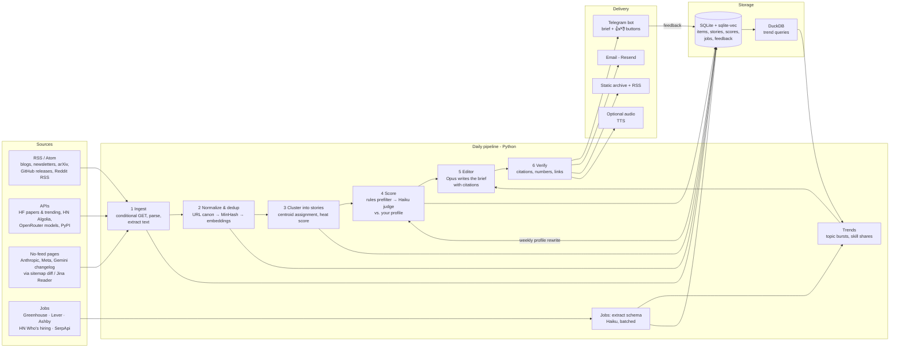

# Architecture proposal: AI_news daily brief

*Draft v0.1, 2026-10-12. Based on [research.md](research.md).*

## 1. Goals

**Goals:**
- **One daily brief**, readable in about 10 minutes, covering what an LLM/GenAI engineer or FDE should know today: models, tools and SDK changes, research, community pulse, enterprise implications, and the job market.
- **Personal relevance over popularity:** rank everything against a written profile of your stack, interests and work, and learn from 👍/👎.
- **Each story once:** collapse the same launch reported by 10 sources into a single story, cite the original, and use the number of independent sources as a "heat" signal.
- **Trends, not just news:** daily rising topics, plus a weekly job-market report on which skills new postings require and how that is shifting.
- **Cheap and low-maintenance:** about $20–35/month all-in, Python, one repo, and self-monitoring sources.

**Non-goals for now:** multi-user SaaS, paid X/Twitter firehose, scraping LinkedIn or Indeed.

## 2. System overview



## 3. Components

### 3.1 Source registry (`config/sources.yaml`)

Every source is data rather than code:

```yaml
- id: simonw
  kind: rss              # rss | api | page_diff | jobs_ats | hn | reddit_rss ...
  url: https://simonwillison.net/atom/everything/
  category: tools        # models | tools | research | community | vendor | newsletter | jobs
  weight: 1.0            # trust / authority prior
  role: primary          # primary (original reporting) | aggregator (links get resolved to originals)
  expect_every: 2d       # health check: alert if nothing new within this window
```

**Aggregator newsletters as votes.** TLDR, AINews, The Rundown and Ben's Bites mostly point at other people's content. Their outbound links are extracted and resolved to the originals. Each mention adds heat to the original story instead of creating a duplicate.

AINews is the exception: it also produces original community chatter, so its text is ingested as content too.

**Health monitor.** Each run records the HTTP status, the number of new items and the last new item per source. The brief's footer lists sources that look dead, such as AINews moving feeds again.

**Starter set (~40 sources):**

| Category | Sources |
|---|---|
| Vendors | OpenAI news + dev changelog, Anthropic (sitemap diff + release notes page), DeepMind, Google Developers, Mistral, HF blog, AWS/Azure/GCP AI release notes (filtered) |
| Models & tools | OpenRouter `/models` diff, HF trending models/spaces, GitHub `releases.atom` for ~25 key repos (vllm, sglang, llama.cpp, ollama, transformers, langgraph, pydantic-ai, anthropic/openai SDKs, mcp, claude-code changelog, dspy, litellm…), OSS Insight trending |
| Research | HF Daily Papers (primary), arXiv cs.CL/cs.LG/cs.AI (fallback + long tail) |
| Community | HN (Algolia, points ≥ threshold, AI keywords), r/LocalLLaMA + r/MachineLearning RSS, Bluesky ML researcher list |
| Newsletters | Latent Space/AINews, Simon Willison, Interconnects, Import AI, TLDR AI, Last Week in AI, Ben's Bites |
| Jobs | ATS boards for ~150–300 AI companies, HN Who's hiring (monthly), SerpApi Google Jobs (~130 queries/mo, free tier), Hiring Lab AI tracker (monthly) |

### 3.2 Ingest

Fetching:
- `httpx` with ETag/Last-Modified and per-host rate limits: arXiv 1 request per 3 s, HN Algolia 10k/h, HF with a token.
- `feedparser` for feeds; `trafilatura` for full text, with Jina Reader as the fallback for JS-heavy pages.
- **Page-diff collector** for pages without a feed: fetch, convert to markdown, diff against the last snapshot, and keep new sections.

Every raw item is stored: `source_id, url, canonical_url, title, published_at, fetched_at, text, text_hash, engagement{points, stars, upvotes}`.

### 3.3 Normalise, dedup and cluster

Dedup runs in three passes:
1. **Canonical URL:** strip tracking parameters, follow redirects, and map arXiv abs/pdf/vN to one ID.
2. **MinHash-LSH** near-duplicate text at Jaccard ≈0.8.
3. **Embeddings** (voyage-4-lite, or local bge-m3) of title + lead. Same story if cosine ≥ ~0.88 within 72 h.

Items are then clustered into stories by assigning each to the nearest existing story centroid, or starting a new story. Story IDs stay stable across days, so follow-ups attach to the same story ("vLLM 0.12 released" → "vLLM 0.12 regression fixed").

**Heat score:** each independent source counts once, weighted by source authority, with a 24 h half-life (the AIHOT approach), plus normalised engagement.

### 3.4 Score (personal relevance)

1. **Cheap prefilter** (no LLM): drop or keep by source, keyword and entity rules; keep anything above a heat threshold. Target: about 150–300 stories/day.
2. **LLM judge.** Claude Haiku 5.5 scores each story against `config/profile.md`, returning strict JSON:
   - `relevance` (0–3)
   - `novelty` vs. the last 14 days of briefs
   - `actionability`
   - `credibility`
   - `section`
   - `fde_angle` (one line)
   - `why_it_matters` (one line)

   The profile and rubric go in a cached prompt prefix. Calls run through the **Batch API** when there's time (50% off).
3. **Final rank** = judge score × heat × source-diversity bonus. About 10% of slots are reserved for exploration so the brief doesn't become a bubble.

### 3.5 Editor (writes the brief)

Claude Opus 5.5 gets the top ~30–40 stories, each with its source excerpts as `document` blocks with **Citations enabled**. It writes the brief in a fixed template (§4). Every claim must carry a citation.

**Verify** runs after the editor:
- Drop any sentence without a citation.
- Every number, model name and version string must appear in the cited source.
- All links must resolve.

Failures are logged to Langfuse.

### 3.6 Jobs pipeline

| Cadence | Steps |
|---|---|
| **Daily** | Poll the ATS boards for the company list and diff against yesterday (new / closed postings). Apply a title regex for the target role families. |
| **Extraction** | Claude Haiku 5.5 with strict structured output (schema in [research.md §3.2](research.md)). Prefer the ATS's own salary and location fields. Store the raw text hash and schema version so postings can be re-extracted. |
| **Daily brief** | "Notable new postings": a handful matching your filters, such as location, remote and seniority. |
| **Weekly report** | Skill and framework share in new postings, week-over-week change, rising skills (by Wilson confidence interval), new companies hiring FDEs, salary bands by role and region, and time-to-close. |
| **Monthly** | HN Who's hiring parse; Hiring Lab macro series. |

**Company list:** the yc-oss list (AI-tagged), Forbes AI 50, frontier and applied-AI labs, and VC portfolio boards. Each candidate slug is probed automatically against Greenhouse, Lever and Ashby. Stored in `config/companies.yaml`.

### 3.7 Trends

- **Daily topic and entity bursts:** today's source-diversity-weighted count compared with 7-day and 28-day baselines (z-score) → a "Rising" section.
- **Weekly:** a BERTopic topic map over the week's stories, plus the job-skill trends. Claude Opus 5.5 writes a weekly "State of the field" summary.

### 3.8 Delivery and feedback

| Channel | Role |
|---|---|
| **Telegram bot** (primary) | Morning brief split into section messages. Each story has buttons: 👍, 👎, 🔇 mute source, ➕ more like this. Feedback is written to SQLite. |
| **Email** (Resend free tier) | The same brief rendered as HTML, for reading on desktop. |
| **Static archive** | A page per brief plus `feed.xml`, so past briefs are searchable and the brief can be read in any RSS reader. |
| **Audio** (optional, phase 4) | A two-voice 5–10 minute version via Gemini Flash TTS, or Google Chirp 3 HD on its free tier. |

**Learning loop:** once a week, Claude rewrites `profile.md` from the past week's feedback; you review the diff. Once there are about 300 labels, a small logistic-regression re-ranker trained on judge sub-scores and metadata is added.

### 3.9 Observability and quality

- **Langfuse** (Cloud Hobby, free) traces every LLM call: cost, latency, prompt version.
- **Run report** in SQLite and the brief footer: items fetched, deduped, judged; cost of the run; dead sources.
- **Golden set:** about 30 hand-labelled days. Measures ranking precision@10 against your thumbs, and summary faithfulness. promptfoo runs regression tests on prompt changes in CI.

## 4. Brief format (draft)

```
AI Brief — Tue 13 Oct 2026                     ~10 min · 34 stories → 12 shown

1. Top 5 — what you must know today (each: 2–3 lines + why it matters to you)
2. Models & pricing — new/updated models, price & context changes (OpenRouter diff)
3. Tools & SDKs — releases, breaking changes, deprecations in your stack
4. Research — 3–5 papers worth your time (HF Daily Papers + arXiv), one-line takeaway each
5. Community pulse — what HN / r/LocalLLaMA / AINews are arguing about
6. FDE corner — enterprise-relevant: compliance, regions, cloud availability, cost/latency
7. Rising — topics with unusual momentum (burst score)
8. Jobs — notable new postings; Monday: weekly skills-trend report
Footer — cost of this run, dead/quiet sources, feedback stats
```

## 5. Deployment

### Recommended: a small VPS (Hetzner CX23, about €6–7/month)

A VPS fits this workload best:
- The Telegram bot needs an always-on process to receive button clicks; long polling avoids needing a public webhook.
- The SQLite database, with vectors and history, should live on a persistent disk.
- There are no platform limits, so scrapers, Playwright or local embedding models can be added later.

| Concern | Setup |
|---|---|
| Runtime | Docker Compose with three services: `pipeline` (run by a systemd timer, or supercronic, at 06:00 local, with a lighter midday refresh), `bot` (always-on Telegram long polling), and `caddy` (serves the static archive over HTTPS). |
| Data | SQLite on the VPS disk, streamed continuously to Cloudflare R2 with **Litestream** for backups (R2 free tier: 10 GB). |
| Deploys | GitHub Actions on push to `main`: test, build the image, push to GHCR, then SSH deploy with a restricted key. |
| Secrets | An `.env` file on the server (mode 600), or sops+age encrypted in the repo. GitHub Actions secrets for CI. No secrets in this public repo. |
| Monitoring | Healthchecks.io (free) pinged at the end of each run; the bot alerts you if a run fails. |

### Zero-cost alternative

This works without a server, but cron punctuality and ToS are weaker:
- **Scheduling:** GitHub Actions in a *private* ops repo, triggered on time by a free Cloudflare cron Worker via `workflow_dispatch`.
- **Database:** Turso instead of local SQLite.
- **Feedback:** a Cloudflare Worker as the Telegram webhook.

Drawbacks:
- More moving parts.
- GitHub's ToS grey area for non-CI workloads.
- Public repos lose their schedules after 60 days without activity.

### Where Claude-native options fit

**Phase 0 baseline:**
- A **Claude Code routine** running daily with web search gives a crude brief on day one.
- It is the bar the real system must beat on relevance, dedup and cost.

**Later:**
- **Managed Agents scheduled deployments** ($0.08 per session-hour plus tokens) suit an optional agentic step, such as "deep-dive the top story: read the repo, docs and discussion, then write a 1-page explainer".
- They are not the core pipeline, which is mostly deterministic.

## 6. Cost estimate (per month)

| Item | Assumption | Cost |
|---|---|---|
| Triage / judge (Haiku 5.5, batched) | ~1,500 items + ~250 stories/day | ~$3–6 |
| Job extraction (Haiku 5.5, batched) | ~300 postings/day | ~$2–4 |
| Daily editor (Opus 5.5) | ~80k input + ~15k output (incl. thinking) per day | ~$19 |
| Weekly trends report (Opus 5.5) | ~200k input + 20k output per week | ~$5 |
| Embeddings (voyage-4-lite) | ~45M tokens | ~$1 (first 200M tokens free) |
| VPS + backups | Hetzner CX23, R2 free tier | ~€6–7 |
| Email, Telegram, SerpApi, Langfuse, TTS | Free tiers | $0 |
| **Total** | | **≈ $35–40/mo** |

With Claude Sonnet 5.5 as the editor ($2/$10 per 1M tokens), the daily editor drops to about $9, for a total of **≈ $25/mo**. This is your call; compare quality on the golden set first.

## 7. Repo layout (proposed)

```
AI_news/
├── config/
│   ├── sources.yaml        # source registry
│   ├── companies.yaml      # ATS slugs for jobs tracking
│   └── profile.md          # who you are / what matters (personal; may stay out of the public repo)
├── src/ainews/
│   ├── collectors/         # rss.py, hf_papers.py, hn.py, github_releases.py, openrouter.py, page_diff.py, ats.py
│   ├── pipeline/           # normalize.py, dedup.py, cluster.py, score.py, editor.py, verify.py
│   ├── jobs/               # extract.py, trends.py
│   ├── trends/             # bursts.py, weekly.py
│   ├── deliver/            # telegram.py, email.py, site.py, tts.py
│   ├── bot/                # feedback handler (long polling)
│   ├── db.py               # SQLite schema + migrations
│   └── cli.py              # `ainews run daily|weekly|jobs|health`
├── prompts/                # versioned prompt files (judge, editor, job extractor, profile rewrite)
├── evals/                  # golden set + promptfoo config
├── deploy/                 # docker-compose.yml, Caddyfile, systemd units, litestream.yml
├── docs/
└── .github/workflows/      # ci.yml, deploy.yml
```

## 8. Roadmap

| Phase | Scope | Outcome |
|---|---|---|
| **0. Baseline** (day 1) | A Claude Code routine / scheduled prompt that writes a daily brief | Something to compare against immediately |
| **1. MVP** (week 1) | Source registry; collectors for RSS, HF Papers, HN, GitHub releases, OpenRouter; SQLite; URL + MinHash dedup; Haiku judge; Opus editor; Telegram delivery. Runs locally on a schedule | A real daily brief |
| **2. Quality** (week 2–3) | Embedding dedup and stable stories, heat score, aggregator-link resolution, feedback buttons, citation verification, Langfuse, static archive + email. Deploy to VPS | Less noise, a feedback loop, production setup |
| **3. Jobs** (week 3–4) | Company list builder, ATS polling, Haiku extraction, weekly skills-trend report, HN Who's hiring | The feature nobody else has |
| **4. Trends & polish** | Burst detection, weekly "State of the field", golden-set evals, profile auto-rewrite, page-diff collectors, optional audio | A brief that compounds over time |

## 9. Open decisions

1. **Delivery channel:** Telegram + email (proposed), or Slack/Discord?
2. **Editor model:** Claude Opus 5.5 (proposed, ~$19/mo) or Claude Sonnet 5.5 (~$9/mo)?
3. **Hosting:** Hetzner VPS (proposed) or the zero-cost GitHub Actions + Cloudflare variant?
4. **Jobs filters:** which locations, remote policy and seniority to watch, and which role families matter most?
5. **Privacy:** the repo is public. `profile.md`, the database and the archive should probably stay private, using a gitignored config or a separate private repo.
